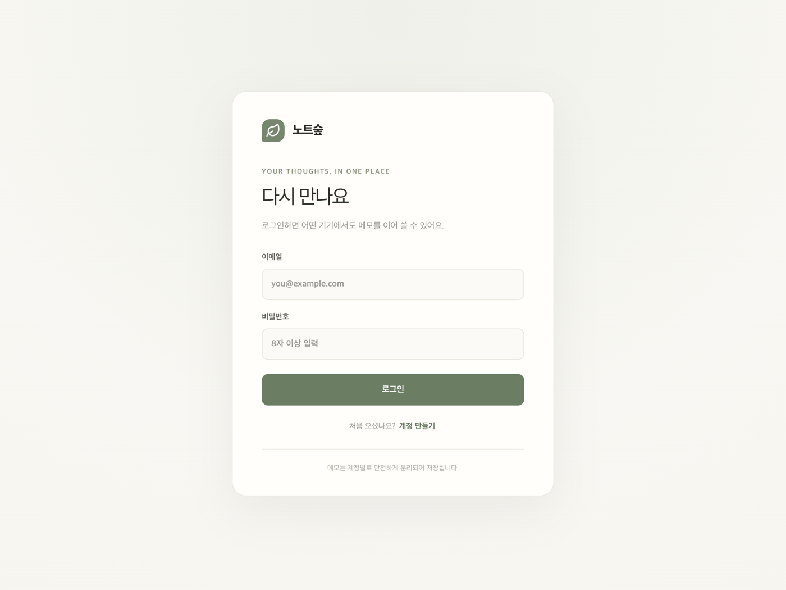

<div align="center">
  
  <h1>노트숲 · Note Forest</h1>
  <p><strong>생각을 가볍게 기록하고, 어디서든 이어 쓰는 나만의 메모 공간</strong></p>
  <p>
    <a href="https://notes.yyyerin.co.kr">웹에서 노트숲 열기</a>
    ·
    <a href="https://github.com/hyr0208/note-forest/releases/latest/download/note-forest-macos.dmg">맥 앱 다운로드</a>
  </p>
</div>

<p align="center">
  
</p>

## 노트숲 소개

노트숲은 메모를 빠르게 작성하고 정리해 여러 기기에서 이어 볼 수 있는 개인용 노트 앱입니다. 웹 브라우저와 설치형 macOS 앱에서 같은 계정으로 사용할 수 있습니다.

## 주요 기능

| 기록과 정리 | 동기화와 관리 |
| --- | --- |
| Markdown 작성 및 미리보기 | 이메일 계정으로 로그인 |
| 폴더, 즐겨찾기, 검색 | 계정별 클라우드 저장과 실시간 동기화 |
| 자동 저장 | 휴지통에서 메모 복원 |
| 메모를 Markdown 파일로 내보내기 | macOS 설치 앱 제공 |

## 기술 스택

- **Frontend:** React, Vite, TypeScript, Tailwind CSS 4
- **Backend:** Supabase Auth, Postgres, Realtime, Row Level Security
- **Markdown:** react-markdown, remark-gfm
- **macOS 앱:** Swift, WKWebView
- **배포:** Cloudflare Pages, GitHub Actions Releases

## 로컬에서 실행하기

```bash
git clone https://github.com/hyr0208/note-forest.git
cd note-forest
npm install
cp .env.example .env.local
```

`.env.local`에 Supabase URL과 Publishable key를 입력한 다음 개발 서버를 실행합니다.

```bash
npm run dev
```

Supabase를 설정하지 않아도 화면을 둘러볼 수 있으며, 이때 작성한 미리보기 메모는 현재 브라우저에만 저장됩니다.

## Supabase 연결

1. Supabase에서 프로젝트를 만듭니다.
2. SQL Editor에서 [`supabase/migrations/20261013000000_notes_folders.sql`](supabase/migrations/20261013000000_notes_folders.sql)을 실행합니다.
3. `.env.local`에 프로젝트 값을 입력합니다.

   ```dotenv
   VITE_SUPABASE_URL=https://your-project.supabase.co
   VITE_SUPABASE_PUBLISHABLE_KEY=your-publishable-key
   ```

4. Supabase Authentication의 URL 설정에서 로컬 주소 `http://localhost:5173`과 배포 주소 `https://notes.yyyerin.co.kr`을 허용합니다.
5. 개발 서버를 다시 시작합니다.

브라우저에는 Publishable key만 사용합니다. `service_role` 키는 `.env.local`이나 저장소에 넣지 마세요. 메모 접근은 마이그레이션에 정의된 RLS 정책으로 사용자 계정별 제한을 적용합니다.

## macOS 앱

배포된 웹 앱을 여는 설치형 앱을 빌드합니다. 메모를 동기화하려면 인터넷 연결이 필요합니다.

```bash
npm run build:macos -- https://notes.yyyerin.co.kr
```

DMG는 `dist/macos/note-forest-macos.dmg`에 생성됩니다. 파일을 열어 `Note Forest.app`을 Applications 폴더로 드래그해 설치합니다.

### GitHub Release 만들기

버전 태그를 푸시하면 GitHub Actions가 macOS 앱을 빌드하고 DMG를 Release에 첨부합니다. `dist`는 Git에서 제외되어 있어 설치 파일을 소스 코드와 별도로 관리합니다.

```bash
git tag v1.0.2
git push origin main v1.0.2
```

`v1.0.2`는 예시입니다. 다음 릴리스에는 아직 사용하지 않은 새 버전 태그를 지정하세요. 설치 파일은 [Releases](https://github.com/hyr0208/note-forest/releases)에서 받을 수 있습니다.

현재 빌드는 개인 설치를 위한 ad-hoc 서명이라 macOS에서 첫 실행을 확인하는 경고가 표시될 수 있습니다. 이 경고 없이 배포하려면 Developer ID 서명과 Apple 공증을 적용해야 합니다.
